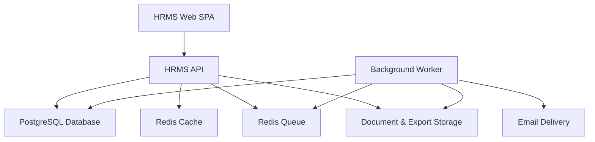
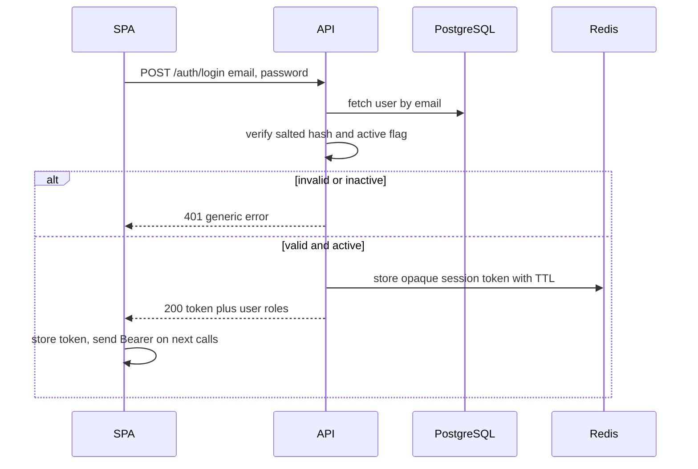
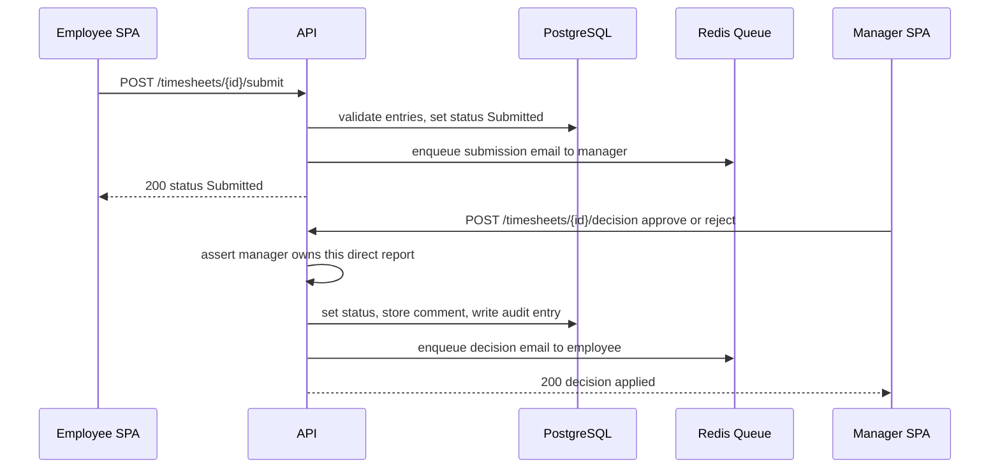
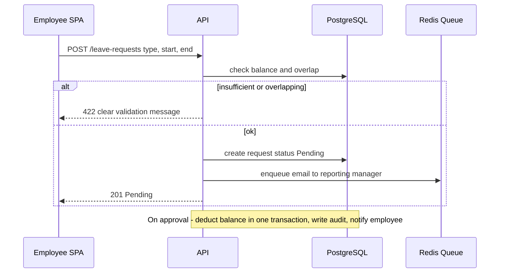
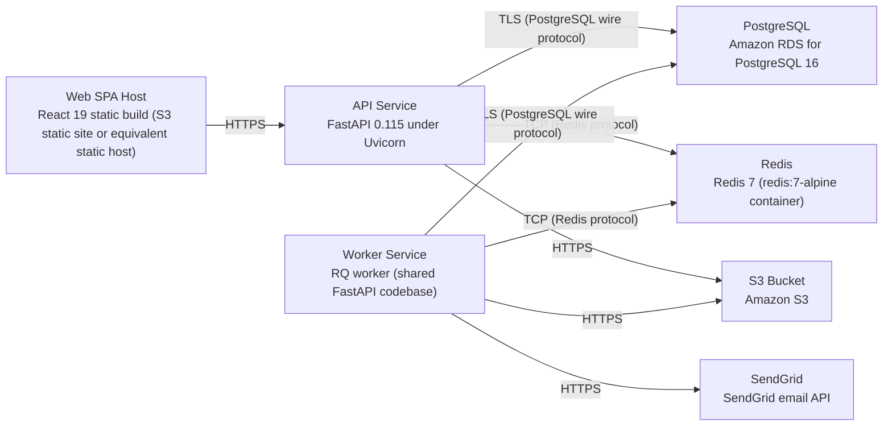

# Architecture

> Maintained by QuorQ AI SDLC. Text between `sdlc:auto` markers is regenerated; anything outside them is yours and is kept.

<!-- sdlc:auto:start narrative -->
## Overview

### ARCH-STACK-FRONTEND · approved · source: architecture:technology_decisions:frontend

React 19 is the approved frontend stack, chosen over Vue and Angular, built as a single Vite SPA on its own origin.

Decision: React 19 (alternatives considered: Vue, Angular) — approved stack. Rationale: built as a Vite single-page app on its own origin; stores the opaque session token and sends it as Authorization: Bearer on every call; one responsive layout serves both the employee's phone and the manager's laptop; role-driven views (approval queues, balance trackers, personal dashboard) render different slices of the same underlying data rather than separate apps per role.

**Related:** ARCH-COMP-FRONTEND

### ARCH-STACK-BACKEND · approved · source: architecture:technology_decisions:backend

FastAPI 0.115 is the approved backend stack, chosen over Django REST Framework and Flask, to express all business rules as a documented API.

Decision: FastAPI 0.115 (alternatives considered: Django REST Framework, Flask) — approved stack. Rationale: expresses the product's rules — RBAC scoping, single-level approvals, leave balance and overlap checks, immutable audit writes — as a documented API the React screens call; automatic OpenAPI docs aid post-launch maintenance; enqueues emails rather than sending them inline so submission/approval requests return immediately.

**Related:** ARCH-COMP-API

### ARCH-STACK-DB · approved · source: architecture:technology_decisions:database

PostgreSQL 16 is the approved database, chosen over MySQL and SQL Server, as the single source of truth for all HRMS data.

Decision: PostgreSQL 16 (alternatives considered: MySQL, SQL Server) — approved stack. Rationale: holds the highly relational HRMS data as the single source of truth; keeps per-employee leave balances and approval status consistent within transactions; jsonb covers flexible audit detail; the append-only audit log is enforced at the database level.

**Related:** ARCH-COMP-DB, ARCH-DATA-MODEL

### ARCH-STACK-CLOUD · approved · source: architecture:technology_decisions:cloud

AWS is the approved cloud platform, chosen over Azure and GCP, hosting all services within private networking.

Decision: AWS (alternatives considered: Azure, GCP) — approved stack. Rationale: hosts the API and worker containers, managed PostgreSQL via RDS (backups and patching handled for sensitive employee data), Redis in a private subnet, and S3 for profile documents and exports, all within private networking appropriate for an internal portal serving ~200-1000 staff.

**Related:** ARCH-DEPLOY

### ARCH-COMP-FRONTEND · approved · source: architecture:components:frontend

HRMS Web SPA (React 19): the single responsive front-end serving all five roles.

Responsive single-page app covering sign-in, personal dashboard, profile, timesheets, leave, holidays, project/department admin, approval queues and audit log views. Stores the opaque session token and sends it as Authorization: Bearer on every API call. Reads the API base URL from the VITE_API_BASE_URL environment variable.

**Related:** ARCH-STACK-FRONTEND, ARCH-CP-LOGIN

### ARCH-COMP-API · approved · source: architecture:components:api

HRMS API (FastAPI 0.115): holds all business rules and is the only component that talks directly to the database.

Covers authentication and session issue/revoke, RBAC scoping, employee/department/project records, timesheet entry and submission, leave application with balance and overlap checks, single-level approvals, holiday calendar, notification fan-out and immutable audit logging. Enqueues email jobs onto the Redis Queue rather than sending them inline, so requests return immediately.

**Related:** ARCH-STACK-BACKEND, ARCH-API-AUTH, ARCH-API-TIMESHEETS, ARCH-API-LEAVE

### ARCH-COMP-WORKER · approved · source: architecture:components:worker

Background Worker: an RQ worker process on the shared FastAPI/Python codebase that sends email and persists exports.

Consumes queued jobs to send notification emails via SendGrid and to persist report/export files to S3. Always writes the in-app notification regardless of email outcome, and logs any email failure, so in-app delivery never depends on SendGrid succeeding.

**Related:** ARCH-COMP-QUEUE, ARCH-COMP-EMAIL, ARCH-COMP-S3

### ARCH-COMP-DB · approved · source: architecture:components:db

PostgreSQL Database (AWS RDS, PostgreSQL 16): single source of truth for all HRMS records.

Stores users, roles, employees, departments, projects, assignments, timesheets, leave types, per-employee balances, leave requests, holidays, notifications and the append-only audit log, enforcing relationships and balance consistency.

**Related:** ARCH-STACK-DB, ARCH-DATA-MODEL

### ARCH-COMP-CACHE · approved · source: architecture:components:cache

Redis Cache (Redis 7): caches active sessions, resolved permissions, and notification counts for fast RBAC checks.

Caches active session tokens and per-user resolved role/permission data and in-app notification counts so RBAC checks stay fast during the morning login peak. Revokes session entries on sign-out and on user deactivation.

**Related:** ARCH-CP-LOGIN

### ARCH-COMP-QUEUE · approved · source: architecture:components:queue

Redis Queue (Redis 7): holds background jobs so submissions and approvals return immediately.

Holds background jobs (notification emails, report generation) so submission and approval requests return immediately without waiting on email delivery. Shares the same Redis 7 container as the cache.

**Related:** ARCH-COMP-WORKER, ARCH-CP-TIMESHEET, ARCH-CP-LEAVE

### ARCH-COMP-S3 · approved · source: architecture:components:object_store

Document & Export Storage (Amazon S3): durable storage for employee documents and generated exports.

Durable storage outside the database for uploaded employee profile documents and generated export files.

**Related:** ARCH-COMP-WORKER

### ARCH-COMP-EMAIL · approved · source: architecture:components:email

Email Delivery (SendGrid): sends notification emails for approvals, rejections and submissions.

Sends approval, rejection and request-submission notification emails to employees and managers. Invoked only by the Background Worker, never inline from the API.

**Related:** ARCH-COMP-WORKER

### ARCH-CP-LOGIN · approved · source: architecture:critical_paths:sign_in_and_session_issue

Sign-in and session issue: how a user authenticates and how the resulting session is stored and protected.

A registered, active user signs in with email and password. The API verifies the salted hash in constant form, returns a generic error on failure without revealing whether the email exists, and rejects deactivated accounts with a distinct message. On success it issues an opaque session token stored in Redis (with expiry) and returned in the response body.

**Related:** ARCH-COMP-API, ARCH-COMP-CACHE, ARCH-API-AUTH

### ARCH-CP-TIMESHEET · approved · source: architecture:critical_paths:timesheet_submit_and_manager_approval

Timesheet submit and manager approval: the end-to-end flow from draft submission to a manager's decision.

An employee submits a draft timesheet for assigned projects; the API validates hours, flips status to Submitted, routes it to the reporting manager and enqueues notifications. The reporting manager, scoped to direct reports only, approves or rejects with a comment, which updates status, writes an audit entry and notifies the employee.

**Related:** ARCH-COMP-API, ARCH-COMP-QUEUE, ARCH-API-TIMESHEETS

### ARCH-CP-LEAVE · approved · source: architecture:critical_paths:leave_application_with_balance_check_and_approval

Leave application with balance check and approval: validation, routing and atomic balance deduction.

An employee applies for leave of a type and date range; the API rejects insufficient balance or overlapping requests, otherwise creates a Pending request routed to the manager. On manager (or HR override) approval the balance is deducted atomically, an audit entry is written and the employee is notified; rejection deducts nothing.

**Related:** ARCH-COMP-API, ARCH-COMP-DB, ARCH-API-LEAVE

### ARCH-DATA-MODEL · approved · source: architecture:entities

Relational data model for HRMS_test, grouped by domain, covering identity, organization, projects, timesheets, leave, holidays, notifications and audit.

Identity & Access: users(id, email, password_hash, is_active, must_set_password, created_at, deactivated_at); roles(id, name); user_roles(user_id, role_id) — permissions combine across all roles assigned to a user. Organization: departments(id, name); employees(id, user_id, full_name, contact_phone, department_id, reporting_manager_id, profile_document_key). Projects: projects(id, name, status, project_manager_id); project_assignments(id, project_id, employee_id, allocated_hours). Timesheets: timesheets(id, employee_id, period_start, period_end, status, reviewer_comment, submitted_at, decided_at); timesheet_entries(id, timesheet_id, project_id, work_date, hours). Leave: leave_types(id, name, annual_entitlement, carry_over_limit); leave_balances(id, employee_id, leave_type_id, balance_days, period_year); leave_requests(id, employee_id, leave_type_id, start_date, end_date, days, status, approver_comment, decided_at). Holidays: holidays(id, holiday_date, name). Notifications & Audit: notifications(id, recipient_user_id, message, is_read, email_status, created_at); audit_logs(id, actor_user_id, action, entity_type, entity_id, detail, created_at) — append-only.

**Related:** ARCH-COMP-DB

### ARCH-API-AUTH · approved · source: architecture:endpoints:auth

Authentication endpoints for login, logout and password set.

POST /auth/login — authenticate with email and password; returns an opaque session token in the body on success; generic error on bad credentials, distinct inactive-account message. POST /auth/logout — revoke the current session token server-side so further requests require sign-in. POST /auth/set-password — set the initial or changed password at first login; stores only a salted hash.

**Related:** ARCH-CP-LOGIN, ARCH-COMP-CACHE

### ARCH-API-USERS · approved · source: architecture:endpoints:users_employees_departments

User, profile, employee and department management endpoints.

GET /me/profile — view own employee profile including department and reporting manager. PATCH /me/profile — update own permitted fields such as contact details; department and reporting manager are read-only. POST /users — HR Admin or System Admin creates a user with unique email and initial details, initial password set at first login; rejects duplicate email. PATCH /users/{id}/roles — System Admin assigns or removes roles; permissions combine across assigned roles. POST /users/{id}/deactivate — deactivate a user so they can no longer sign in; existing sessions invalidated on next request; record retained. POST /employees — HR Admin creates/edits employee records including department and reporting manager; rejects a non-existent or inactive manager. POST /departments — HR Admin adds or renames departments; delete blocked while employees assigned.

**Related:** ARCH-DATA-MODEL

### ARCH-API-PROJECTS · approved · source: architecture:endpoints:projects

Project creation and assignment endpoints for Project Managers.

POST /projects — Project Manager creates/maintains projects with name and status; inactive projects cannot be selected for new entries. POST /projects/{id}/assignments — Project Manager assigns an employee with allocated hours to their own project; denied for projects they do not own.

**Related:** ARCH-DATA-MODEL

### ARCH-API-TIMESHEETS · approved · source: architecture:endpoints:timesheets

Timesheet creation, submission, decision and listing endpoints.

POST /timesheets — create or update a draft timesheet with daily entries against assigned projects; rejects unassigned project, negative hours or more than 24 hours per day. POST /timesheets/{id}/submit — submit a draft timesheet; status becomes Submitted, routed to reporting manager, no longer editable until decided. POST /timesheets/{id}/decision — Reporting Manager (or HR Admin override) approves or rejects a direct report's timesheet with a comment; writes audit and notifies. GET /timesheets — list own timesheets with current status and reviewer comment where rejected.

**Related:** ARCH-CP-TIMESHEET

### ARCH-API-LEAVE · approved · source: architecture:endpoints:leave

Leave type configuration, balance management, application and decision endpoints.

POST /leave-types — HR Admin defines leave types with entitlement and carry-over rule as data. PUT /employees/{id}/leave-balances — HR Admin sets or adjusts an employee's balance per leave type; adjustment recorded in audit log. POST /leave-requests — employee applies for leave of a type and date range; rejects insufficient balance or overlap, otherwise creates Pending and routes to manager. POST /leave-requests/{id}/decision — Reporting Manager (or HR Admin override) approves or rejects a direct report's leave with comment; approval deducts balance, rejection deducts nothing; notifies. GET /me/leave-balances — view own remaining balance per leave type, reflecting approved deductions. GET /me/leave-requests — view own leave history with dates, type, status and approver comment.

**Related:** ARCH-CP-LEAVE

### ARCH-API-HOLIDAYS · approved · source: architecture:endpoints:holidays

Organisation holiday calendar endpoints.

GET /holidays — view the organisation holiday calendar with dates and names. POST /holidays — HR Admin adds, edits or removes public holidays on the single org calendar.

### ARCH-API-DASHBOARD · approved · source: architecture:endpoints:dashboard_notifications

Personal dashboard and in-app notification endpoints.

GET /me/dashboard — personal dashboard summarising own recent timesheet status and current leave balances, highlighting pending or rejected items; own data only. GET /me/notifications — list own in-app notifications; served fast from cache.

**Related:** ARCH-COMP-CACHE

### ARCH-API-AUDIT · approved · source: architecture:endpoints:audit

Audit log viewing endpoint restricted to System Admin.

GET /audit-logs — System Admin views and filters the immutable audit log by user or date range; denied to all other roles.

**Related:** ARCH-DATA-MODEL

### ARCH-DEPLOY · approved · source: architecture:deployment_nodes

Deployment topology on AWS: static SPA host, containerised API and worker, managed Postgres and Redis, S3, and external SendGrid.

Web SPA Host: React 19 static build served as an S3 static site or equivalent static host, over HTTPS. API Service: FastAPI 0.115 under Uvicorn, Python 3.12 container on AWS (ECS/Fargate or EC2). Worker Service: RQ worker on the shared FastAPI codebase, Python 3.12 container on AWS. PostgreSQL: Amazon RDS for PostgreSQL 16, managed, private subnet. Redis: Redis 7 (redis:7-alpine container) in a private subnet, serving both cache and queue roles. S3 Bucket: Amazon S3, managed object storage. SendGrid: external SaaS email API reached over HTTPS.

**Related:** ARCH-STACK-CLOUD, ARCH-COMP-FRONTEND, ARCH-COMP-API, ARCH-COMP-WORKER, ARCH-COMP-DB, ARCH-COMP-CACHE, ARCH-COMP-S3, ARCH-COMP-EMAIL
<!-- sdlc:auto:end narrative -->

<!-- sdlc:auto:start building-blocks -->
## Building Block View

| ID | Name | Technology | Responsibility | Depends on |
|---|---|---|---|---|
| frontend | HRMS Web SPA | React 19 | Responsive single-page app for all five roles: sign-in, personal dashboard, profile, timesheets, leave, holidays, project/department admin, approval queues and audit log views. Stores the opaque session token and sends it as Authorization: Bearer on every API call. Reads the API base URL from VITE_API_BASE_URL. | api |
| api | HRMS API | FastAPI 0.115 | FastAPI service holding all business rules: authentication and session issue/revoke, RBAC scoping, employee/department/project records, timesheet entry and submission, leave application with balance and overlap checks, single-level approvals, holiday calendar, notifications fan-out and immutable audit logging. Enqueues email jobs rather than sending inline. | db, cache, queue, object_store |
| worker | Background Worker | FastAPI 0.115 (RQ worker process, shared Python codebase) | Consumes queued jobs to send notification emails via SendGrid and to persist report/export files to S3. Writes in-app notifications regardless of email outcome and logs any email failure. | db, queue, email, object_store |
| db | PostgreSQL Database | PostgreSQL 16 (AWS RDS) | Single source of truth for users, roles, employees, departments, projects, assignments, timesheets, leave types, per-employee balances, leave requests, holidays, notifications and the append-only audit log, enforcing relationships and balance consistency. | — |
| cache | Redis Cache | Redis 7 | Caches active session tokens and per-user resolved role/permission data and in-app notification counts so RBAC checks stay fast during the morning login peak; revokes session entries on sign-out and deactivation. | — |
| queue | Redis Queue | Redis 7 | Holds background jobs (notification emails, report generation) so submission and approval requests return immediately without waiting on email delivery. | — |
| object_store | Document & Export Storage | Amazon S3 | Durable storage outside the database for uploaded employee profile documents and generated export files. | — |
| email | Email Delivery | SendGrid | Sends approval, rejection and request-submission notification emails to employees and managers. | — |

<!-- sdlc:auto:end building-blocks -->

<!-- sdlc:auto:start runtime -->
## Runtime View

### Sign-in and session issue

A registered, active user signs in with email and password. The API verifies the salted hash in constant form, returns a generic error on failure without revealing whether the email exists, rejects deactivated accounts, and on success issues an opaque session token stored in Redis (with expiry) and returned in the response body.

- **Components:** frontend, api, db, cache
- **Modules:** auth.router, auth.service, security.hashing, session.store
- **Key functions:** login(email, password), verify_password(password, hash), issue_session(user_id), revoke_session(token)

### Timesheet submit and manager approval

An employee submits a draft timesheet for assigned projects; the API validates hours, flips status to Submitted, routes it to the reporting manager and enqueues notifications. The reporting manager, scoped to direct reports only, approves or rejects with a comment, which updates status, writes an audit entry and notifies the employee.

- **Components:** frontend, api, db, queue, worker, cache
- **Modules:** timesheet.router, timesheet.service, rbac.scope, approval.service, audit.service, notification.service
- **Key functions:** submit_timesheet(timesheet_id, user), assert_direct_report(manager, employee), decide_timesheet(timesheet_id, decision, comment, approver), write_audit(actor, action, record, ts), enqueue_email(job)

### Leave application with balance check and approval

An employee applies for leave of a type and date range; the API rejects insufficient balance or overlapping requests, otherwise creates a Pending request routed to the manager. On manager (or HR override) approval the balance is deducted atomically, an audit entry is written and the employee is notified; rejection deducts nothing.

- **Components:** frontend, api, db, queue, worker
- **Modules:** leave.router, leave.service, balance.service, rbac.scope, approval.service, audit.service
- **Key functions:** apply_leave(type_id, start, end, user), check_balance(employee_id, type_id, days), check_overlap(employee_id, start, end), decide_leave(request_id, decision, comment, approver), deduct_balance(employee_id, type_id, days)

<!-- sdlc:auto:end runtime -->

<!-- sdlc:auto:start deployment-view -->
## Deployment View

| Name | Service | Runtime | Scaling | Environment |
|---|---|---|---|---|
| Web SPA Host | React 19 static build (S3 static site or equivalent static host) | Static assets served over HTTPS | CDN/static, single origin | dev |
| API Service | FastAPI 0.115 under Uvicorn | Python 3.12 container on AWS (ECS/Fargate or EC2) | 1-2 instances for dev, horizontal | dev |
| Worker Service | RQ worker (shared FastAPI codebase) | Python 3.12 container on AWS | 1 instance for dev | dev |
| PostgreSQL | Amazon RDS for PostgreSQL 16 | Managed PostgreSQL 16, private subnet | Single instance with automated backups | dev |
| Redis | Redis 7 (redis:7-alpine container) | Container in private subnet, serves both cache and queue | Single instance for dev | dev |
| S3 Bucket | Amazon S3 | Managed object storage | Managed | dev |
| SendGrid | SendGrid email API | External SaaS over HTTPS | Managed | dev |

| Source | Target | Protocol |
|---|---|---|
| Web SPA Host | API Service | HTTPS |
| API Service | PostgreSQL | TLS (PostgreSQL wire protocol) |
| API Service | Redis | TCP (Redis protocol) |
| API Service | S3 Bucket | HTTPS |
| Worker Service | Redis | TCP (Redis protocol) |
| Worker Service | PostgreSQL | TLS (PostgreSQL wire protocol) |
| Worker Service | SendGrid | HTTPS |
| Worker Service | S3 Bucket | HTTPS |

<!-- sdlc:auto:end deployment-view -->

<!-- sdlc:auto:start decisions -->
## Architecture Decisions

| Layer | Choice | ADR |
|---|---|---|
| Frontend | React 19 | [ADR-0001](adr/frontend.md) |
| Backend | FastAPI 0.115 | [ADR-0002](adr/backend.md) |
| Database | PostgreSQL 16 | [ADR-0003](adr/database.md) |
| Cloud | AWS | [ADR-0004](adr/cloud.md) |
<!-- sdlc:auto:end decisions -->

<!-- sdlc:auto:start links -->
## Related Documents

- [Data Model](data-model.md)
- [API Specification](api/openapi.yaml)
- [Architecture Decision Records](adr/README.md)
<!-- sdlc:auto:end links -->
