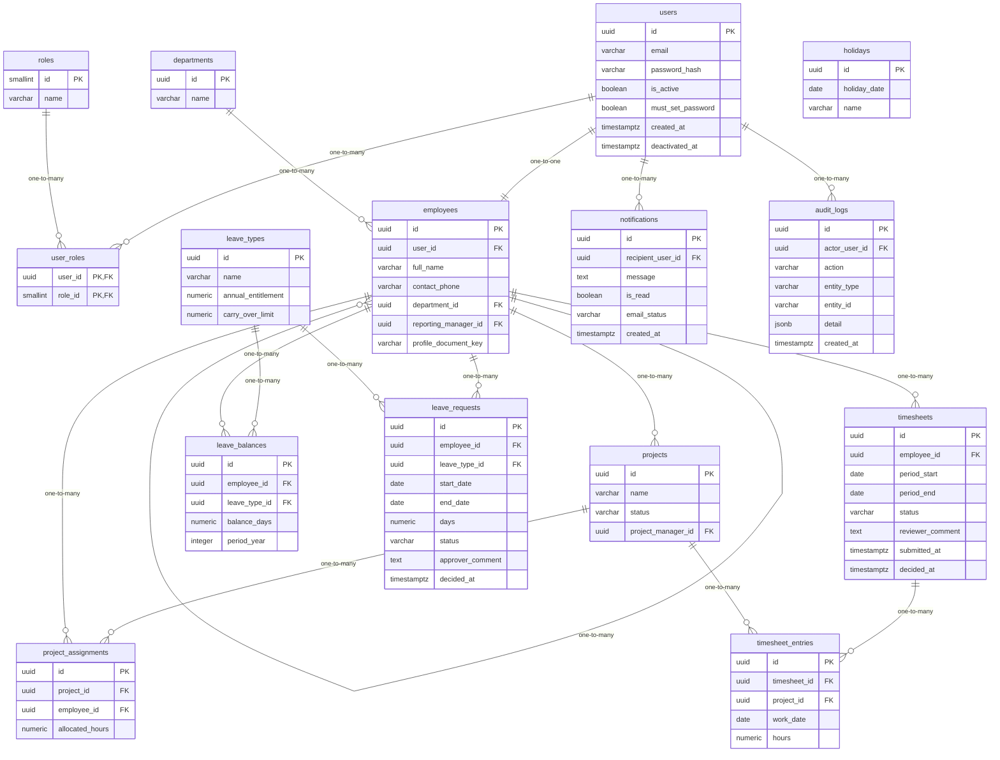

# Data Model

<!-- sdlc:auto:start entities -->
### users

| Field | Type | PK | FK | Nullable |
|---|---|---|---|---|
| id | uuid | True | — | False |
| email | varchar | False | — | False |
| password_hash | varchar | False | — | False |
| is_active | boolean | False | — | False |
| must_set_password | boolean | False | — | False |
| created_at | timestamptz | False | — | False |
| deactivated_at | timestamptz | False | — | True |

### roles

| Field | Type | PK | FK | Nullable |
|---|---|---|---|---|
| id | smallint | True | — | False |
| name | varchar | False | — | False |

### user_roles

| Field | Type | PK | FK | Nullable |
|---|---|---|---|---|
| user_id | uuid | True | users.id | False |
| role_id | smallint | True | roles.id | False |

### departments

| Field | Type | PK | FK | Nullable |
|---|---|---|---|---|
| id | uuid | True | — | False |
| name | varchar | False | — | False |

### employees

| Field | Type | PK | FK | Nullable |
|---|---|---|---|---|
| id | uuid | True | — | False |
| user_id | uuid | False | users.id | False |
| full_name | varchar | False | — | False |
| contact_phone | varchar | False | — | True |
| department_id | uuid | False | departments.id | True |
| reporting_manager_id | uuid | False | employees.id | True |
| profile_document_key | varchar | False | — | True |

### projects

| Field | Type | PK | FK | Nullable |
|---|---|---|---|---|
| id | uuid | True | — | False |
| name | varchar | False | — | False |
| status | varchar | False | — | False |
| project_manager_id | uuid | False | employees.id | False |

### project_assignments

| Field | Type | PK | FK | Nullable |
|---|---|---|---|---|
| id | uuid | True | — | False |
| project_id | uuid | False | projects.id | False |
| employee_id | uuid | False | employees.id | False |
| allocated_hours | numeric | False | — | True |

### timesheets

| Field | Type | PK | FK | Nullable |
|---|---|---|---|---|
| id | uuid | True | — | False |
| employee_id | uuid | False | employees.id | False |
| period_start | date | False | — | False |
| period_end | date | False | — | False |
| status | varchar | False | — | False |
| reviewer_comment | text | False | — | True |
| submitted_at | timestamptz | False | — | True |
| decided_at | timestamptz | False | — | True |

### timesheet_entries

| Field | Type | PK | FK | Nullable |
|---|---|---|---|---|
| id | uuid | True | — | False |
| timesheet_id | uuid | False | timesheets.id | False |
| project_id | uuid | False | projects.id | False |
| work_date | date | False | — | False |
| hours | numeric | False | — | False |

### leave_types

| Field | Type | PK | FK | Nullable |
|---|---|---|---|---|
| id | uuid | True | — | False |
| name | varchar | False | — | False |
| annual_entitlement | numeric | False | — | False |
| carry_over_limit | numeric | False | — | False |

### leave_balances

| Field | Type | PK | FK | Nullable |
|---|---|---|---|---|
| id | uuid | True | — | False |
| employee_id | uuid | False | employees.id | False |
| leave_type_id | uuid | False | leave_types.id | False |
| balance_days | numeric | False | — | False |
| period_year | integer | False | — | False |

### leave_requests

| Field | Type | PK | FK | Nullable |
|---|---|---|---|---|
| id | uuid | True | — | False |
| employee_id | uuid | False | employees.id | False |
| leave_type_id | uuid | False | leave_types.id | False |
| start_date | date | False | — | False |
| end_date | date | False | — | False |
| days | numeric | False | — | False |
| status | varchar | False | — | False |
| approver_comment | text | False | — | True |
| decided_at | timestamptz | False | — | True |

### holidays

| Field | Type | PK | FK | Nullable |
|---|---|---|---|---|
| id | uuid | True | — | False |
| holiday_date | date | False | — | False |
| name | varchar | False | — | False |

### notifications

| Field | Type | PK | FK | Nullable |
|---|---|---|---|---|
| id | uuid | True | — | False |
| recipient_user_id | uuid | False | users.id | False |
| message | text | False | — | False |
| is_read | boolean | False | — | False |
| email_status | varchar | False | — | False |
| created_at | timestamptz | False | — | False |

### audit_logs

| Field | Type | PK | FK | Nullable |
|---|---|---|---|---|
| id | uuid | True | — | False |
| actor_user_id | uuid | False | users.id | False |
| action | varchar | False | — | False |
| entity_type | varchar | False | — | False |
| entity_id | varchar | False | — | False |
| detail | jsonb | False | — | True |
| created_at | timestamptz | False | — | False |
<!-- sdlc:auto:end entities -->

<!-- sdlc:auto:start relationships -->
| Source | Target | Type |
|---|---|---|
| users | user_roles | one-to-many |
| roles | user_roles | one-to-many |
| users | employees | one-to-one |
| departments | employees | one-to-many |
| employees | employees | one-to-many |
| employees | projects | one-to-many |
| projects | project_assignments | one-to-many |
| employees | project_assignments | one-to-many |
| employees | timesheets | one-to-many |
| timesheets | timesheet_entries | one-to-many |
| projects | timesheet_entries | one-to-many |
| leave_types | leave_balances | one-to-many |
| employees | leave_balances | one-to-many |
| employees | leave_requests | one-to-many |
| leave_types | leave_requests | one-to-many |
| users | notifications | one-to-many |
| users | audit_logs | one-to-many |
<!-- sdlc:auto:end relationships -->

<!-- sdlc:auto:start er-diagram -->

<!-- sdlc:auto:end er-diagram -->
