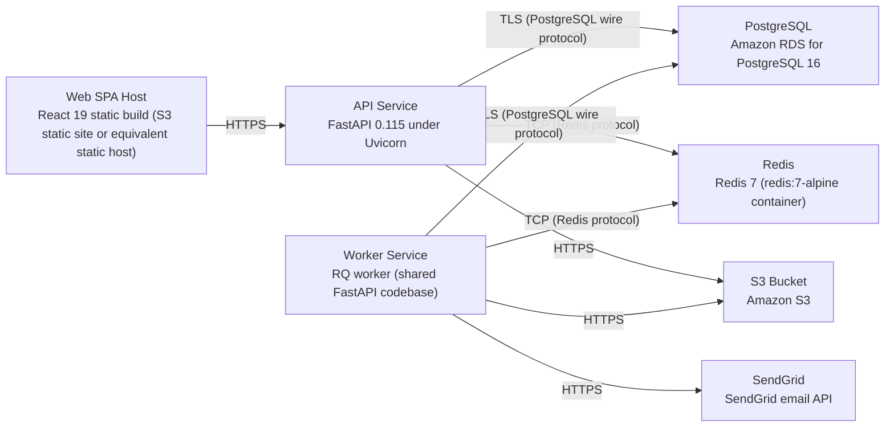

# Deployment Guide

> Maintained by QuorQ AI SDLC. Text between `sdlc:auto` markers is regenerated; anything outside them is yours and is kept.

<!-- sdlc:auto:start how-it-deploys -->
Pushes to `main` run `.github/workflows/deploy.yml`, which builds the API image (if there is a backend) and deploys the SPA to AWS Amplify. Commits touching only `docs/sdlc/**` don't deploy. Deployments can also be started from the platform's Deployment tab.
<!-- sdlc:auto:end how-it-deploys -->

<!-- sdlc:auto:start environments -->
| Name | Service | Runtime | Scaling | Environment |
|---|---|---|---|---|
| Web SPA Host | React 19 static build (S3 static site or equivalent static host) | Static assets served over HTTPS | CDN/static, single origin | dev |
| API Service | FastAPI 0.115 under Uvicorn | Python 3.12 container on AWS (ECS/Fargate or EC2) | 1-2 instances for dev, horizontal | dev |
| Worker Service | RQ worker (shared FastAPI codebase) | Python 3.12 container on AWS | 1 instance for dev | dev |
| PostgreSQL | Amazon RDS for PostgreSQL 16 | Managed PostgreSQL 16, private subnet | Single instance with automated backups | dev |
| Redis | Redis 7 (redis:7-alpine container) | Container in private subnet, serves both cache and queue | Single instance for dev | dev |
| S3 Bucket | Amazon S3 | Managed object storage | Managed | dev |
| SendGrid | SendGrid email API | External SaaS over HTTPS | Managed | dev |
<!-- sdlc:auto:end environments -->

<!-- sdlc:auto:start live -->
_Not deployed yet._
<!-- sdlc:auto:end live -->

<!-- sdlc:auto:start topology -->

<!-- sdlc:auto:end topology -->
